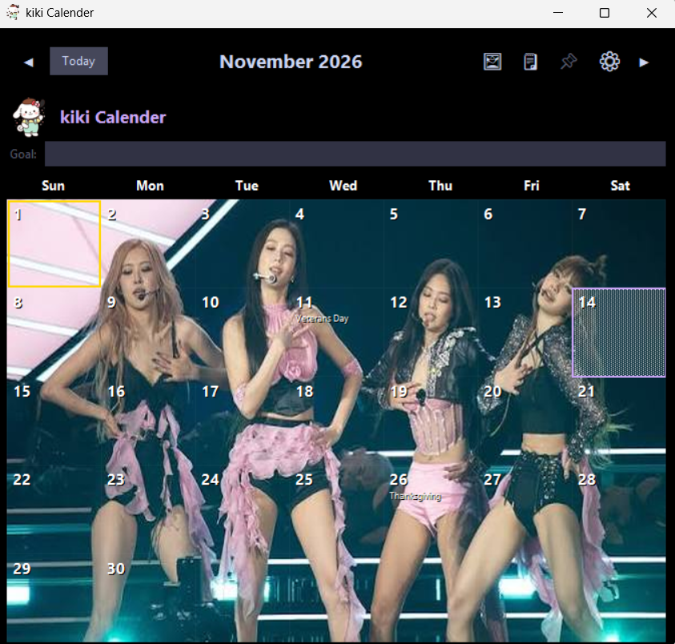
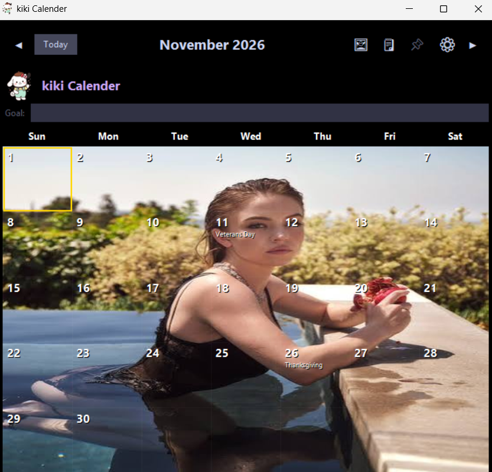
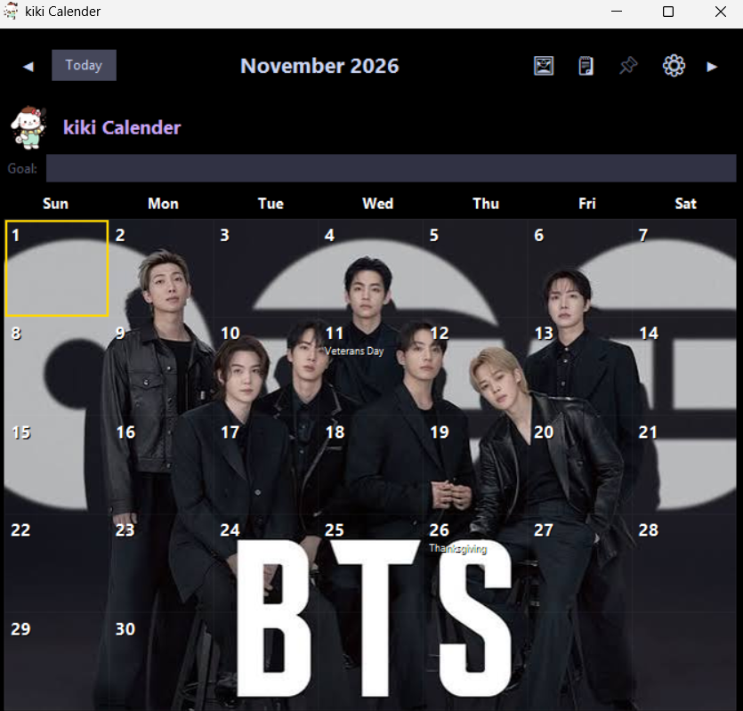
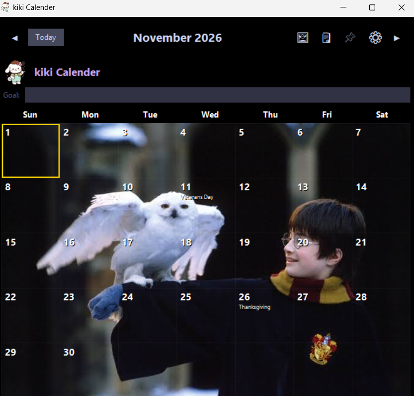

# kiki_Calender_free backgrond calender_customizable wallpapers_free calender_free 2027 calendar printable

> Bring your favorite stars and goals to your desktop — Desktop calendar with customizable wallpapers, live PC & mobile sync, and 100% free access.

## Download

**[⬇ Download kiki_Calender_free backgrond calender_customizable wallpapers_free calender_free 2027 calendar printable 1.0.0 (latest)](https://github.com/jjosh1001/kiki/releases/latest)**

| File | Size | SHA-256 |
|---|---|---|
| `kiki_Calender_free backgrond calender_customizable wallpapers_free calender_free 2027 calendar printable.exe` | 68.5 MB | `920c1c00b9f91bdc78af31964dbf8aa510556fb10c9811ad0dfc5d81b5d841bd` |

## About

1. Customize Your Desktop with Your Favorites and Goals
- Fan & Motivation: Set pictures of your favorite stars, characters, or goal images (fitness, certifications, bucket lists) as your desktop wallpaper.
- Optimized Readability: Adjust widget transparency and fonts to keep your schedule neat and easy to read without covering your wallpaper.

2. Perfect Real-Time PC ↔ Mobile Sync
- Schedules entered on your PC automatically sync with the mobile app instantly, ensuring you never miss a plan while on the go.

3. 100% Free License
- Access full features on both PC and mobile with no feature limits or required payments.

4. Intuitive Schedule Management & Widget Features
- Supports essential scheduling tools like D-day counters, quick notes, and important reminders. Flexible placement and resizing allow it to blend into any workspace.

## Features

- 1. Customize Your Desktop with Your Favorites and Goals
- - Fan & Motivation: Set pictures of your favorite stars, characters, or goal images (fitness, certifications, bucket lists) as your desktop wallpaper.
- - Optimized Readability: Adjust widget transparency and fonts to keep your schedule neat and easy to read without covering your wallpaper.
- 2. Perfect Real-Time PC ↔ Mobile Sync
- - Schedules entered on your PC automatically sync with the mobile app instantly, ensuring you never miss a plan while on the go.
- 3. 100% Free License
- - Access full features on both PC and mobile with no feature limits or required payments.
- 4. Intuitive Schedule Management & Widget Features
- - Supports essential scheduling tools like D-day counters, quick notes, and important reminders. Flexible placement and resizing allow it to blend into any workspace.

## Screenshots

## Requirements

- Windows 10 / 11 (64-bit)

## Install

1. Download `kiki_Calender_free backgrond calender_customizable wallpapers_free calender_free 2027 calendar printable.exe` from the [latest release](https://github.com/jjosh1001/kiki/releases/latest).
2. Run it and follow the installer.
3. Windows SmartScreen may warn about an unrecognized publisher for new/unsigned apps: click **More info → Run anyway**.

Verify the download (PowerShell): `Get-FileHash .\kiki_Calender_free backgrond calender_customizable wallpapers_free calender_free 2027 calendar printable.exe -Algorithm SHA256`

## Support

Found a bug or have a request? [Open an issue](https://github.com/jjosh1001/kiki/issues). If kiki_Calender_free backgrond calender_customizable wallpapers_free calender_free 2027 calendar printable is useful, a ⭐ star helps others find it.

License: Freeware
